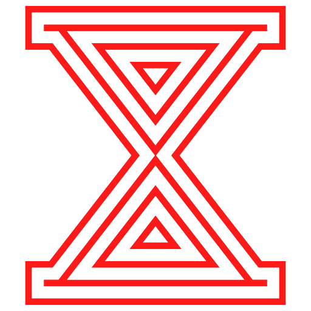
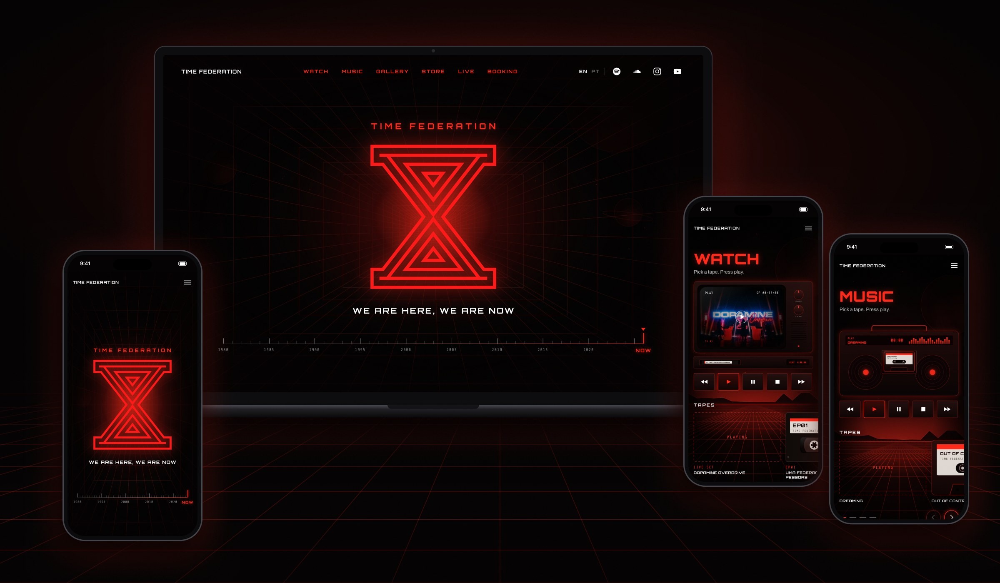

  

<h1 align="center">Time Federation</h1>

  <a href="#computer-projeto">Projeto</a>&nbsp;&nbsp;&nbsp;|&nbsp;&nbsp;&nbsp;
  <a href="#bulb-como-funciona">Como funciona</a>&nbsp;&nbsp;&nbsp;|&nbsp;&nbsp;&nbsp;
  <a href="#sparkles-funcionalidades">Funcionalidades</a>&nbsp;&nbsp;&nbsp;|&nbsp;&nbsp;&nbsp;
  <a href="#eyes-site">Site</a>&nbsp;&nbsp;&nbsp;|&nbsp;&nbsp;&nbsp;
  <a href="#rocket-tecnologias">Tecnologias</a>&nbsp;&nbsp;&nbsp;|&nbsp;&nbsp;&nbsp;
  <a href="#bookmark-layout">Layout</a>&nbsp;&nbsp;&nbsp;|&nbsp;&nbsp;&nbsp;
  <a href="#memo-licença">Licença</a>

  
  
  
  

  

## :computer: Projeto

Site oficial da **Time Federation**, trio de música eletrônica que mistura sintetizadores dos anos 80, synthwave e a ideia de viagem no tempo. **WE ARE HERE, WE ARE NOW.**

A banda já tinha um press kit para contratantes. Este site é outra coisa: o ponto de encontro dos fãs e de quem quer levar o show para o seu evento. Ali ficam os vídeos, as músicas, as fotos, a agenda, a loja e o booking.

A direção visual nasceu do próprio conceito da banda: em vez de cards e players genéricos, cada mídia aparece como era nos anos 80. Os vídeos são **fitas VHS** que entram num videocassete e passam numa **TV de tubo**; as músicas são **fitas cassete** que tocam num **rádio**; a agenda é um **painel de aeroporto** com plaquinhas que viram.

## :bulb: Como funciona

- **A equipe edita sem mexer em código.** Todo o conteúdo (vídeos, músicas, fotos, shows, loja, WhatsApp e redes) fica no **Sanity**, um painel online onde a banda entra com e-mail ou Google, preenche e clica em *Publish*.
- **O site se atualiza sozinho.** Ao publicar, o Sanity avisa a Netlify, que monta o site de novo em cerca de um minuto, com as páginas já prontas em inglês e português.
- **Nunca fica fora do ar por causa do painel.** Se o Sanity não responder na hora de montar o site, ele usa uma cópia do conteúdo que fica no próprio projeto.
- **Um player por vez.** Ao dar play numa música, o vídeo pausa, e vice-versa. Ao sair da seção, o que estiver tocando também pausa.
- **Testa antes de publicar.** O painel tem uma área de Produção e uma de Homologação. A homologação alimenta a branch `hml` e os links de pré-visualização, então dá para testar conteúdo e código sem mexer no site oficial.

## :sparkles: Funcionalidades

**Seções do site**

| Seção | O que tem |
|---|---|
| **Home** | Túnel do tempo em movimento, a ampulheta oficial se desenhando ao abrir e uma régua de 1980 até NOW |
| **Storytelling** | A história da Federação num arquivo confidencial de terminal antigo, com a ficha de cada integrante |
| **Watch** | Live set e série documental como fitas VHS. A fita escolhida voa até o videocassete, entra pela abertura e a TV liga com chiado antes do vídeo começar |
| **Music** | Lançamentos como fitas cassete, do mais novo para o mais antigo. A fita cai no rádio, os carretéis giram e o equalizador acompanha a música (player oficial do Spotify) |
| **Gallery** | Mosaico de fotos com ampliação em tela cheia, navegável por teclado e por gesto no celular |
| **Store** | Página da jaqueta oficial, com a compra feita no Shopify |
| **Live** | Agenda num painel de aeroporto que vira as plaquinhas ao aparecer na tela, com próximos shows e shows anteriores |
| **Join** | Convite de recrutamento com crachá de agente, levando ao grupo da banda no WhatsApp |
| **Booking** | Contratação direto pelo WhatsApp |

**Detalhes que fazem diferença**

- **Mobile first**, com telas pensadas para celular, tablet e desktop.
- **Bilíngue**: `/en/` e `/pt/`, com o idioma escolhido automaticamente na primeira visita.
- **Prateleiras com carrossel**: quando há mais fitas do que cabem na tela, um pedaço da próxima aparece cortado na borda, para ficar claro que tem mais.
- **Seções controladas pelo painel**: a equipe muda a ordem das seções (e do menu), liga ou desliga cada uma e edita o nome e o subtítulo, sem mexer no código. Store e Live começam desligadas.
- **Fitas sem informação repetida**: o nome da música fica inteiro na etiqueta da fita e diminui sozinho quando é comprido.
- **Acessível**: navegação por teclado, foco visível e respeito à opção *reduzir movimento* do sistema, que desliga o que pisca e se repete, mas mantém as animações que contam a história.
- **Leve**: sem framework no navegador, players carregados só no primeiro play e fotos entregues no tamanho certo de cada tela.

## :eyes: Site

Você pode acessar o site [aqui](https://timefederation.netlify.app/).

## :rocket: Tecnologias

Esse projeto foi desenvolvido com as seguintes tecnologias:

         

Para quem quer mexer no código

Você precisa do [Node.js](https://nodejs.org/) 22 ou mais novo.

    npm install
    npm run dev        # site em http://localhost:8080/en/
    npm run preview    # mostra também Store e Live, que ficam desligadas em produção
    npm run build      # versão de produção na pasta _site/

Com `SANITY_DISABLED=1`, o site é montado só com o conteúdo local, sem consultar o Sanity.

Painel do Sanity:

    cd studio
    npm install
    npm run dev        # painel em http://localhost:3333
    npm run deploy     # publica o painel depois de mudar a estrutura dos campos

**Onde fica cada coisa**

    src/_data/        dados de cada seção (lê o Sanity e, se falhar, src/content)
    src/_includes/    estrutura da página e uma parte para cada seção
    src/assets/       CSS, JavaScript, imagens e os SVGs do fundo
    src/content/      cópia local do conteúdo (JSON)
    studio/           painel do Sanity: campos e organização das seções
    lib/cms.js        consulta ao Sanity e funções de apoio
    netlify.toml      build, redirecionamento por idioma e ambientes

**Ambientes**

| Branch | Para que serve | Painel do Sanity |
|---|---|---|
| `main` | Produção | Produção |
| `hml` | Homologação | Homologação |
| outras | Cada pull request para a `hml` ganha um link de pré-visualização na Netlify | Homologação |

O painel tem duas áreas, com o mesmo formato: **Produção** alimenta o site oficial e **Homologação** serve para testar conteúdo sem mexer no que está no ar.

Chaves de serviços externos ficam nas variáveis de ambiente da Netlify, nunca no repositório.

## :bookmark: Layout

Você pode visualizar o layout do projeto através [desse link](https://www.figma.com/design/un7oelDJ5ErgD39d34ecfT/Time-Federation). Lembrando que você precisa ter uma conta no [Figma](https://www.figma.com/) para acessá-lo.

## :memo: Licença

Copyright (c) 2026 Priscilla Pinheiro. Todos os direitos reservados.

O código está público apenas para visualização, como portfólio. Não é permitido copiar, modificar ou usar este código em outros projetos sem autorização. Veja o arquivo [LICENSE](LICENSE).

O nome Time Federation, a ampulheta, as fotos, as músicas e os demais elementos da marca pertencem à **Time Federation**, com todos os direitos reservados.
